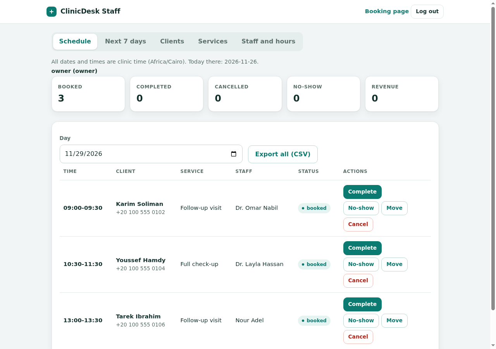
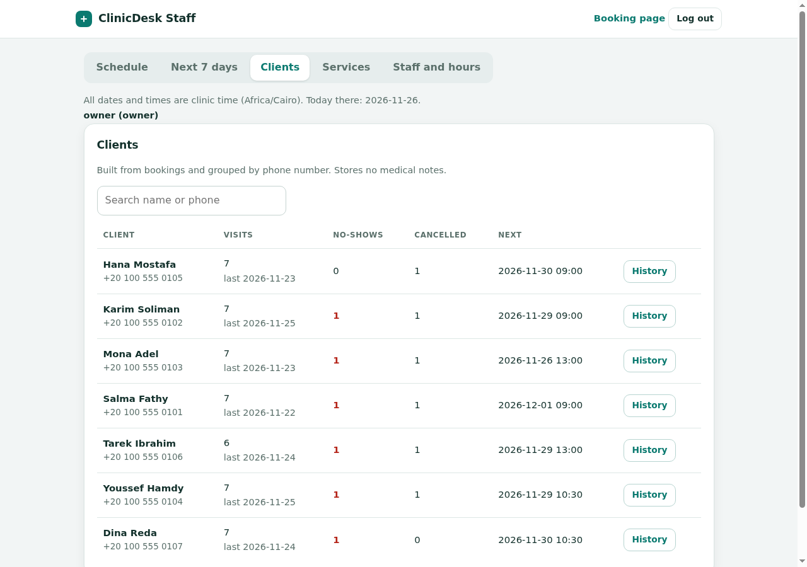
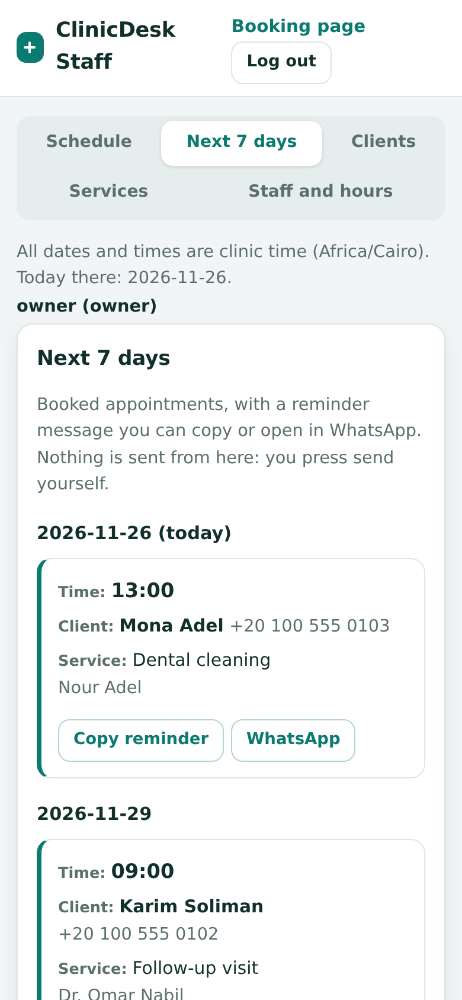

# ClinicDesk

Appointment booking and a small back office for clinics and salons. Local demo project. It stores appointment details only (name, phone, service, time), no medical records. All people and phone numbers in the demo data are fictional placeholders (zeros).

_Screenshots of the running app with fictional demo data (captured from the real app in Chrome)._

## Run
Needs Node 22 or newer. No packages to install.

    npm start                  # http://127.0.0.1:3000
    SEED_DEMO=1 npm start      # same, plus fictional demo bookings on a brand-new database
    npm test                   # 48 automated tests (28 baseline + 20 reliability layer)
    node docs/e2e.js           # real server + real Chrome run with a restart (needs google-chrome)

First run: open `/admin`. With no account in the database you are asked to create the staff account yourself (username, password of at least 10 characters). That form only works while no account exists. There are no default or shared credentials.

Settings by environment variable: `PORT` (3000), `HOST` (127.0.0.1, local only), `DB` (clinic.db), `CLINIC_TZ` (Africa/Cairo, read when the database is first created).

## Restore: STOP THE SERVER FIRST
`node backup.js restore BACKUP TARGET` is only safe with the server stopped. Steps: stop the server, run `verify`, run `restore`, start the server again. The command checks for journal/WAL marker files, but that guard CANNOT tell that a server is stopped: an idle running server leaves no marker. A reviewer reproduced stale reads, 500 read-only errors and a write landing in the renamed pre-restore copy after a live restore; restarting restores consistency. Do not treat live restore as safe. Private fictional-data prototype only.

## Time zone
There is one clinic time zone. Every date and time in the database and screens is clinic wall-clock time. "Today" and "time has passed" are computed in that zone, not the server's. The staff page and booking page show the zone. Changing it later means editing the `settings` table, and existing bookings are not converted. Default working week in the seed data is Sunday to Thursday.

## Features
Public: choose service, staff or anyone, date, free slot; confirm with name and phone; a 128-bit booking code lets the client cancel.
Staff (login required):
- Schedule: day view, complete, no-show, cancel, move in an in-page dialog with that staff member's free slots, daily totals, CSV export.
- Next 7 days: booked appointments grouped by day, each with a ready reminder message to copy, or to open in WhatsApp when the phone number has a +country code. Nothing is sent by the app.
- Clients: built from bookings and grouped by phone number, with visit, no-show and cancellation counts, next booking, search and per-client history. No medical notes are stored.
- Services: add, edit name/length/price, deactivate (hidden from booking).
- Staff and hours: add, deactivate, edit weekly hours per day, add or remove days off. Adding a day off does not move existing bookings, the screen tells you how many exist.
No double booking, including simultaneous requests.

## Security notes
Passwords hashed with scrypt. Session cookie HttpOnly and SameSite=Strict; logout deletes the session on the server, so a copied old cookie stops working. Login throttling (5 failures per minute per IP) and per-IP rate limits on booking, lookup and cancel. Public lookup returns no personal data. CSV export neutralises spreadsheet formulas. Inputs validated, pages escape output.
Not security-reviewed. Before real use: serve over HTTPS (the cookie is not marked Secure), put it behind a reverse proxy, add backups, and review privacy rules for storing client phone numbers. Rate limits are in memory and per process. One staff role only, no password reset, no email/SMS reminders, no payments.

## Tests
The original 23 unit and HTTP tests (now 48 in total with the reliability layer, see AUDIT.md) (slot rules, overlaps, validation, cancel/move, time zone, services/staff/hours, setup flow, access control, rate limits, concurrency, restart persistence on a file database) plus `docs/e2e.js`, which ran a real server, restarted it and checked bookings, prices and login survived, then used the mobile staff page to move, complete and cancel bookings. Screenshots from that run are in `docs/`.

## UI revision (v2)
`public/style.css` was rewritten and `public/admin.html` got one markup change (a status class on schedule rows). No server, API, element-ID or behavior changes. Screenshots in `docs/` were regenerated from the restyled app with fictional demo data (`docs/e2e.js`, `docs/e2e-roles.js`, `docs/showcase.js`). The `docs/` shots are made in a headless Chrome, not on a real phone. The restore warning above is unchanged and still applies. The UI revision is not yet a git commit in this zip (working tree on local/reliability-layer).
